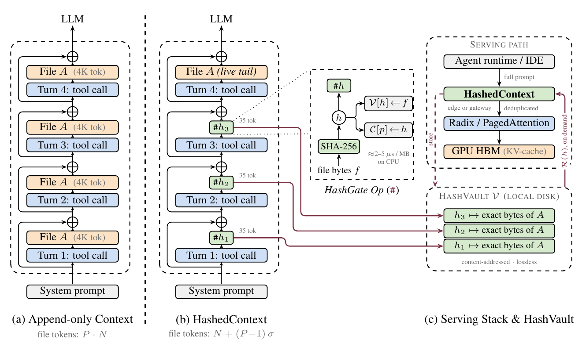

# HashedContext

**Scaling GPU KV-Cache Efficiency and Inference Concurrency for Autonomous Agents**

[](https://doi.org/10.5281/zenodo.23668958)
[](LICENSE)


> **Preprint, not peer-reviewed.** Version v0.1 is permanently archived on Zenodo with a DOI. Draft v0.2 (in this repository) adds figures and minor fixes; the method and the measured results are unchanged.

**Author:** Rahat Hasan · [Akkhar-Labs](https://github.com/Akkhar-Labs) · Bogura, Bangladesh · ORCID [0009-0003-6184-5269](https://orcid.org/0009-0003-6184-5269)

| Version | Date | PDF | Archive |
|---|---|---|---|
| **v0.2 draft** (latest) | 2026-10-27 | [`paper/HashedContext-draft-v0.2.pdf`](paper/HashedContext-draft-v0.2.pdf) | this repository |
| v0.1 | 2026-10-26 | [`paper/HashedContext-draft-v0.1.pdf`](paper/HashedContext-draft-v0.1.pdf) | Zenodo · [10.5281/zenodo.23668958](https://doi.org/10.5281/zenodo.23668958) |

The concept DOI [10.5281/zenodo.23668957](https://doi.org/10.5281/zenodo.23668957) always resolves to the newest version archived on Zenodo.



*Figure 1 of the paper. (a) Append-only agents keep one full copy of a file per turn. (b) HashedContext replaces historical copies with ~35-token SHA-256 stubs and keeps one live copy at the prompt tail. (c) Historical bytes live in a local content-addressed vault and are resolved on demand.*

---

## The problem

Autonomous coding agents (Claude Code, Cursor, Cline, Devin, …) re-send the same unchanged source files into the conversation on almost every turn. Over a long session, prompt size grows roughly as `O(M × N × P)` (files × tokens per file × turns). That wastes GPU KV-cache memory, slows prefill and decoding, and limits how many sessions an inference server can serve concurrently.

## The idea

HashedContext is a **content-addressed context architecture** for multi-turn agents. It treats conversation history as a *state-transition log*, not a filesystem archive:

1. **SHA-256 hash-gated file tracking:** every file observation is hashed before it is serialized.
2. **Historical deduplication via `[HASH_STUB]`:** past copies of a file are replaced by a compact (~35-token) stub.
3. **Attention-anchored authoritative tail:** exactly one live, full copy of each active file sits at the end of the prompt.
4. **On-demand resolution from a local HashVault:** any historical version can be restored losslessly by its hash when needed.

```
[HASH_STUB]
path: src/auth/session.ts
sha256: e4b2c91f…8741aa
state: CACHED
[/HASH_STUB]
```

It can run **client-side** (IDE extensions, agent CLIs) or **server-side** as a gateway filter in front of engines like vLLM or SGLang, with no changes to model weights or the inference engine.

## Early results

Initial measurements on DeepSeek V4 production endpoints (5-turn refactoring session on a ~4,000-token TypeScript file):

| Metric | Conventional | HashedContext | Reduction |
|---|---:|---:|---:|
| Prompt tokens (turn 4) | 27,747 | 11,746 | **57.7%** |
| Normalized turn 5 | 31,747 | 11,746 | **63.0%** |
| File-specific tokens | 20,000 | 4,140 | **79.3%** |

In this initial evaluation, the model still detected a single-line mutation in the authoritative tail with no observed loss in diff-tracking accuracy.

> Larger-scale benchmarks (more models, tasks, and session lengths) are in progress. All figures in the paper other than the table above are analytical projections from the paper's cost model, not measurements, and are labelled as such.

## What's new in v0.2

- New system overview diagram in the Introduction (Figure 1), replacing the text-only comparison figure of v0.1: append-only vs. HashedContext context stacks, the HashGate operation, and the serving stack with the HashVault.
- Five new figures from the paper's analytical model:
  - resident KV-cache over a session vs. post-hoc compaction (§2.4)
  - prompt assembly and the authoritative tail (§3.2)
  - GPU memory budget and batch concurrency on one 80 GB GPU (§5.5)
  - radix-tree / prefix-cache structure across sessions and exploration branches (§7.3)
  - cumulative cost of runaway agent loops under a fixed budget (§8.4)
- Figure tracing measured file-token residency turn by turn (§11).
- Typesetting fix for the code listings in §11.

## Status

- [x] Architecture and formal model
- [x] Early benchmark on a production endpoint
- [x] Preprint archived on Zenodo with a DOI (v0.1)
- [x] Figures for architecture, memory, caching, and cost analysis (v0.2)
- [ ] Extended benchmarks across models and workloads
- [ ] Reference implementation
- [ ] Submission to arXiv / a peer-reviewed venue

## Related work by the author

- [ZRCP](https://github.com/sover-labs/zrcp): hash-based protocol specification for eliminating redundant context between AI agents
- [Brud Code](https://github.com/rahatarch/brud): deterministic paste-and-apply execution engine for AI-assisted coding

## Citation

If you reference this work, please cite the archived version (see also [`CITATION.cff`](CITATION.cff)):

```bibtex
@misc{hasan2026hashedcontext,
  title     = {Scaling GPU KV-Cache Efficiency and Inference Concurrency for Autonomous Agents with HashedContext},
  author    = {Hasan, Rahat},
  year      = {2026},
  publisher = {Zenodo},
  version   = {v0.1},
  doi       = {10.5281/zenodo.23668958},
  url       = {https://doi.org/10.5281/zenodo.23668958}
}
```

## License

The paper is licensed under [CC BY 4.0](LICENSE). You may share and adapt it with attribution.

## Contact

Rahat Hasan · [rahathasan5773@gmail.com](mailto:rahathasan5773@gmail.com) · [github.com/rahatarch](https://github.com/rahatarch)
